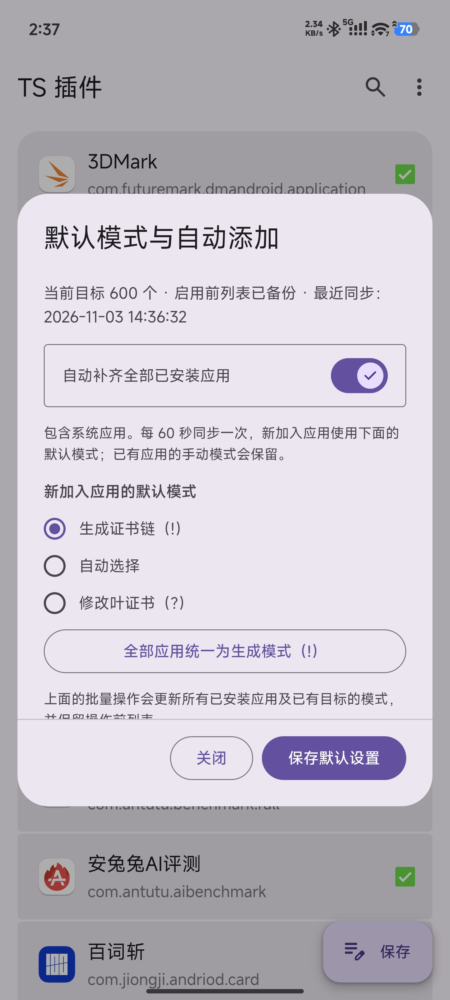
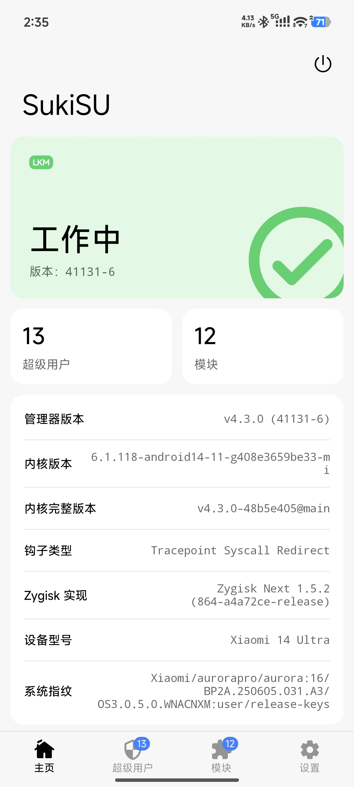
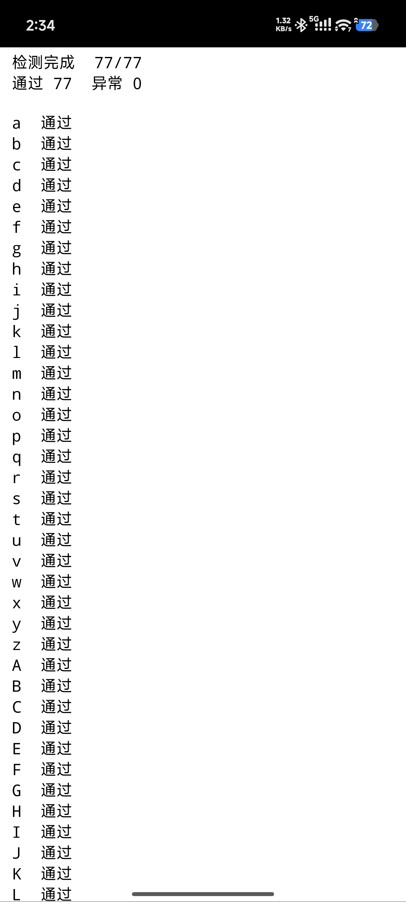
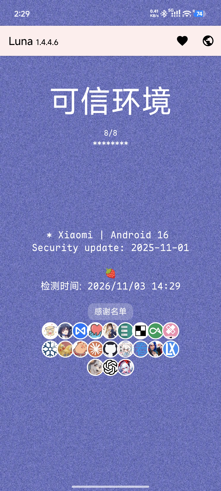
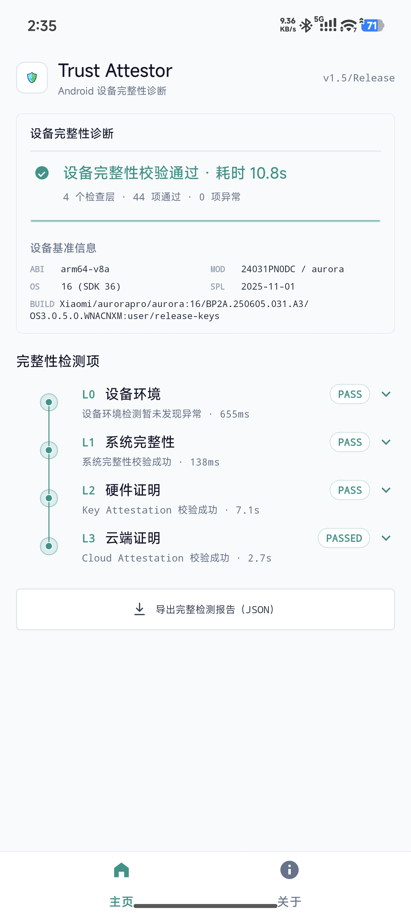

# TrickyAddon · 目标管理增强版

基于 TrickyAddon 739674-canary，增加默认模式、自动加入应用、批量调整和备份恢复。习惯使用 **! 模式** 时，可以把目标列表维护集中在 WebUI 中完成。

基于版本：**739674-canary**。增强维护：[Moderate-Qi](https://github.com/Moderate-Qi)。

## 相比原版增加

- **新增应用默认使用 ! 模式。** 默认选择“生成证书链（!）”，也可以在 WebUI 调整默认模式。
- **自动补齐已安装应用。** 开启后每 60 秒同步一次，覆盖系统应用与用户应用，新安装应用会在后续同步中加入。
- **保留手动指定的模式。** 已有应用的个人设置继续沿用，自动添加与手动管理配合使用。
- **一键全部设为 !。** 提供批量调整按钮，统一设置更方便。
- **自动备份与恢复。** 保存启用自动管理前的目标列表，WebUI 提供恢复入口。
- **同步情况直接显示。** 查看当前目标数量和最近同步时间，方便确认列表更新。

## 使用方式

1. 从本仓库 Releases 下载 `TrickyAddon-739674-targets.2.zip`，在 SukiSU Ultra 中刷入并重启。
2. 打开模块 WebUI，进入“默认模式与自动添加”。
3. 选择新增应用的默认模式，按需开启“自动补齐全部已安装应用”，保存设置。
4. 希望统一调整时，使用“全部应用统一为生成模式（!）”；日常个别应用继续手动设置。

## 实测环境

小米 14 Ultra，HyperOS 3.0.5.0，Android 16，SukiSU Ultra v4.3.0 / 41131-6（LKM），Zygisk Next 1.5.2（864），LSPosed 2.2.1（7912）。系统原始安全补丁日期为 2025-11-01。

## 界面与实测截图

### TrickyAddon：自动添加、默认 ! 模式与同步状态

### 实测框架：SukiSU Ultra 41131-6 与 Zygisk Next 1.5.2

### 配合 TS-OSS：TEE Demo 1.7 通过 77 项

### 配合 TS-OSS：Luna 1.4.4.6 可信环境

### 配合日期管理：Trust Attestor 四层通过

## 来源、版权与许可证

上游项目：[739674 / e7d95a0；KOWX712 及原项目贡献者](https://github.com/KOWX712/Tricky-Addon-Update-Target-List)。功能增强、集成和文档由 Moderate-Qi 维护，保留原作者署名与第三方版权记录。

[Apache-2.0](LICENSE)。具体修改、来源和构建入口见 [CHANGELOG_LOCAL.md](CHANGELOG_LOCAL.md)、[NOTICE.md](NOTICE.md) 和 [BUILDING.md](BUILDING.md)。

## 配套项目

- [PIF 日期管理增强版](https://github.com/Moderate-Qi/PlayIntegrityFix)
- [TS-OSS 199 兼容增强版](https://github.com/Moderate-Qi/TrickyStoreOSS)
- [HMA-OSS UID 一体化增强版](https://github.com/Moderate-Qi/HMA-OSS-UID)
- [DuckUSB Service 服务增强版](https://github.com/Moderate-Qi/DuckUSB-Service)

## 免责声明

如有侵权请联系我删除。

仅代表本人使用的当前系统和当前环境下的实测结果，且通过相关检测器不代表所有软件都检测不到环境异常，请勿用于游戏作弊等场景。
